# Dispensador hospitalario de medicamento líquido con autenticación Face ID y control en FPGA DE10-Lite

**Proyecto final · Sistemas Embebidos · Universidad de las Américas Puebla · Otoño 2026**

| Estudiante | ID |
|---|---|
| Victor Hugo De La Calleja Mojica | 181626 |
| Rodrigo Daniel Carretero Santamaría | 180293 |

**Profesor:** Dr. Gerardo Ulises Díaz Arango · **Fecha:** 27 de noviembre de 2026
**Reporte completo:** [reporte/reporte.pdf](reporte/reporte.pdf)

<p align="center">
  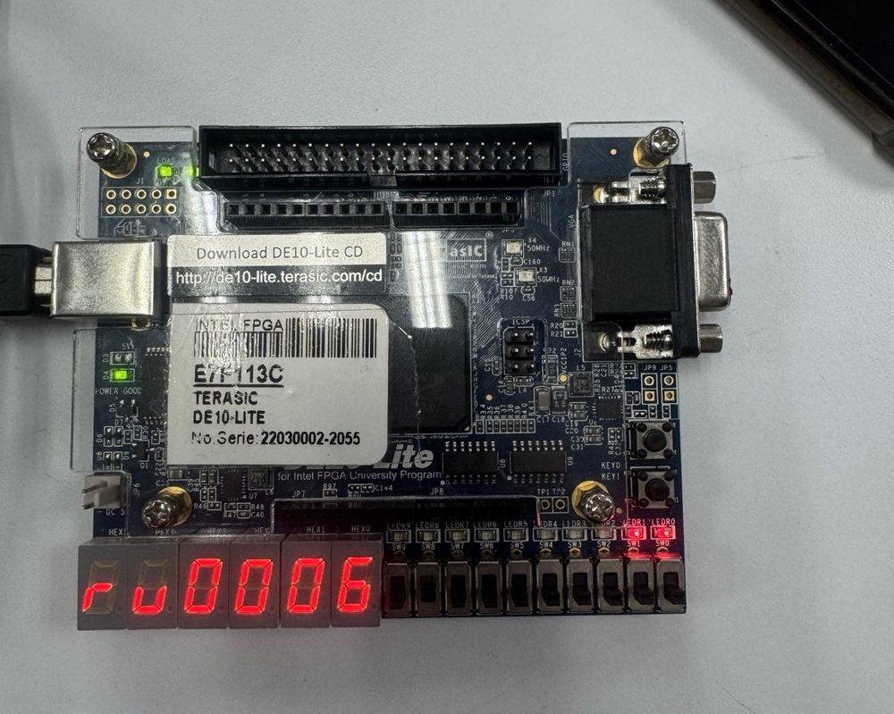
  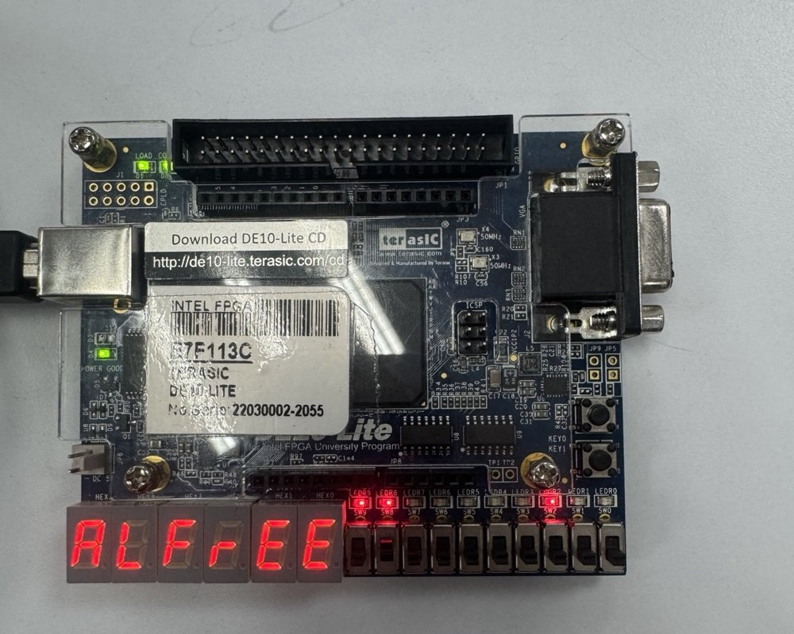
  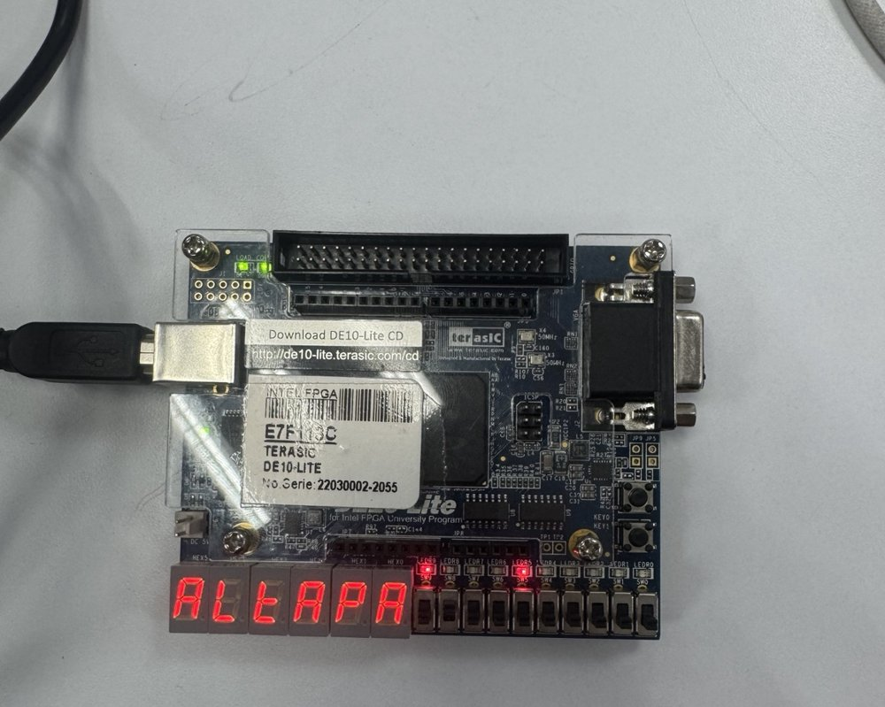
  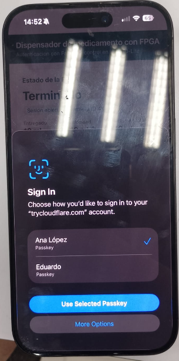
</p>

---

## Contenido

1. [Resumen](#1-resumen)
2. [Introducción: problema, objetivos y alcance](#2-introducción)
3. [Estado del arte y originalidad](#3-estado-del-arte-y-originalidad)
4. [Diagramas del sistema](#4-diagramas-del-sistema)
5. [Metodología de implementación](#5-metodología-de-implementación)
6. [Protagonismo de la FPGA](#6-protagonismo-de-la-fpga)
7. [Casos de estudio](#7-casos-de-estudio)
8. [Resultados](#8-resultados)
9. [Análisis comparativo](#9-análisis-comparativo)
10. [Conclusiones y trabajo futuro](#10-conclusiones-y-trabajo-futuro)
11. [Instrucciones de ejecución](#11-instrucciones-de-ejecución)
12. [Estructura del repositorio](#12-estructura-del-repositorio)
13. [Referencias](#13-referencias)

---

## 1. Resumen

En un hospital, una bomba de infusión con llaves accesibles permite que un paciente o un familiar modifique el flujo o se administre dosis adicionales de un medicamento, por ejemplo un analgésico. Este proyecto implementa un **dispensador de medicamento líquido en una FPGA Terasic DE10-Lite (Intel MAX 10)** en el que cada acción sensible requiere **Face ID** de un iPhone.

- **Identidad:** se verifica con llaves de acceso (*passkeys*) del estándar WebAuthn [2].
- **Laptop:** un servidor en Python valida la firma y envía la orden a la FPGA por el mismo cable USB-Blaster con el que se programa, mediante el bloque *In-System Sources and Probes* [7].
- **FPGA:** toma todas las decisiones:
  - sesión de enfermería con tiempo límite;
  - rangos de los parámetros e identidad del paciente;
  - dosificación gota a gota en lazo cerrado;
  - límite de bolos tipo PCA;
  - detección de alarmas.

**Resultados principales:**

- **Recursos:** el diseño ocupa **2,595 elementos lógicos (5 %)** y cierra tiempos a 50 MHz con **Fmax = 72.81 MHz**.
- **Verificación:** **268 comprobaciones en simulación**, **29 pruebas del servidor** y **nueve escenarios en la tarjeta**.
- **Detección de fallas en la tarjeta:**
  - flujo libre en **0.7 s**;
  - ausencia de flujo en **5.6 s**;
  - apertura no autorizada del gabinete en **0.1 s**.
- **Rechazos:** la FPGA rechazó parámetros fuera de rango, bolos durante el tiempo de bloqueo y solicitudes hechas con el rostro de otra persona.

No se compró ningún componente: solo se usaron la tarjeta, una laptop y un iPhone.

**Palabras clave:** FPGA, DE10-Lite, Verilog, Face ID, WebAuthn, passkeys, JTAG, bomba de infusión, analgesia controlada por el paciente.

---

## 2. Introducción

### Problema y motivación

Las bombas de infusión administran medicamentos líquidos a una velocidad programada. La FDA reporta que han tenido **problemas de seguridad persistentes** que pueden causar sobreinfusión, subinfusión o terapia omitida o retrasada, muchos de ellos asociados a deficiencias de diseño [1].

En equipos sencillos, o cuando el medicamento se controla con una llave manual, el paciente o un acompañante puede abrir el flujo o pedir más dosis de las indicadas. En analgesia controlada por el paciente (PCA) esto se evita con un tiempo de bloqueo entre dosis y un máximo por hora, pero **esas reglas solo funcionan si nadie más puede pedir la dosis ni cambiar el programa**.

La autenticación biométrica del teléfono resuelve esto sin hardware adicional. Con WebAuthn [2], el iPhone guarda una llave privada que solo se usa después de verificar el rostro con Face ID [3], [4]. El servidor recibe únicamente una firma que comprueba con la llave pública, y nunca conoce la llave privada [3]. Así, cada orden queda asociada a una persona concreta y no a quien tenga el equipo en la mano.

### Objetivos

1. Implementar en la FPGA la función principal del dispensador: dosificación gota a gota en lazo cerrado, límite de bolos, detección de alarmas y validación de todas las órdenes.
2. Autenticar a la enfermera y al paciente con Face ID del iPhone y llevar sus órdenes a la FPGA sin agregar módulos de comunicación.
3. Verificar el diseño en simulación y en la tarjeta DE10-Lite, incluyendo los intentos de uso no autorizado y las fallas físicas del equipo.

### Alcance

| Incluido | Fuera del alcance |
|---|---|
| Lógica completa del dispensador en Verilog sobre la DE10-Lite | Bomba peristáltica y sensor de gotas físicos (se modelan dentro de la FPGA) |
| Autenticación con Face ID real desde un iPhone | App nativa de iOS (se usa Safari) |
| Simulación de fallas físicas (llave, tubo, gabinete) con switches o desde la página | Certificación clínica o pruebas con medicamento |
| Pruebas automáticas y en la tarjeta | Servidor en la nube con dominio fijo |

---

## 3. Estado del arte y originalidad

### Soluciones relacionadas

| Solución | Cómo controla el acceso | Limitación frente a este problema |
|---|---|---|
| Venoclisis por gravedad con llave de rodillo | Ninguno: la llave está al alcance de cualquiera | No limita dosis ni detecta manipulación |
| Bomba volumétrica con bloqueo de teclado | Código o bloqueo del panel | El código se comparte entre el personal; no identifica a la persona |
| Bomba PCA con llave física | Llave del gabinete y tiempo de bloqueo | La llave identifica a quien la tiene, no a quien la usa; el paciente pulsa un botón sin verificación de identidad |
| Lector de huella o tarjeta RFID en el equipo | Biometría o credencial | Requiere comprar e integrar hardware adicional; una tarjeta puede prestarse |
| **Este proyecto** | **Face ID por persona (passkey ligada a un rol e ID) + reglas en hardware** | **Sin hardware extra; cada orden queda atribuida a una persona y la FPGA aplica las reglas** |

### Qué es original

- **Biometría sin hardware adicional:** el Face ID del iPhone, que ya traen enfermeras y pacientes, se usa como factor de identidad mediante passkeys estándar [2], sin app nativa ni Mac.
- **La seguridad clínica vive en hardware:** la laptop solo verifica la firma y transporta órdenes. Roles, rangos, paciente asignado, bolos y alarmas se deciden en la FPGA. Una orden indebida que llegue de la laptop se rechaza y queda registrada.
- **El cable de programación como canal de datos:** el bloque *In-System Sources and Probes* [7] permite leer y escribir registros del diseño por JTAG [8]. No se agregó ESP32, UART ni Wi-Fi.
- **El bolo pertenece al paciente:** solo la passkey del paciente asignado puede pedirlo, y el limitador PCA en hardware aplica el tiempo de bloqueo y el máximo por hora.

---

## 4. Diagramas del sistema

### 4.1 Diagrama de bloques

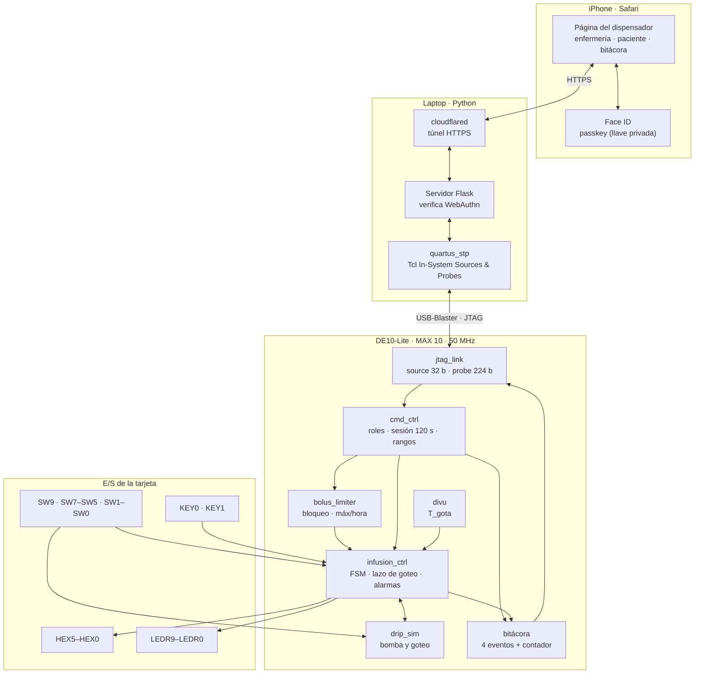

### 4.2 Diagrama de flujo general del sistema

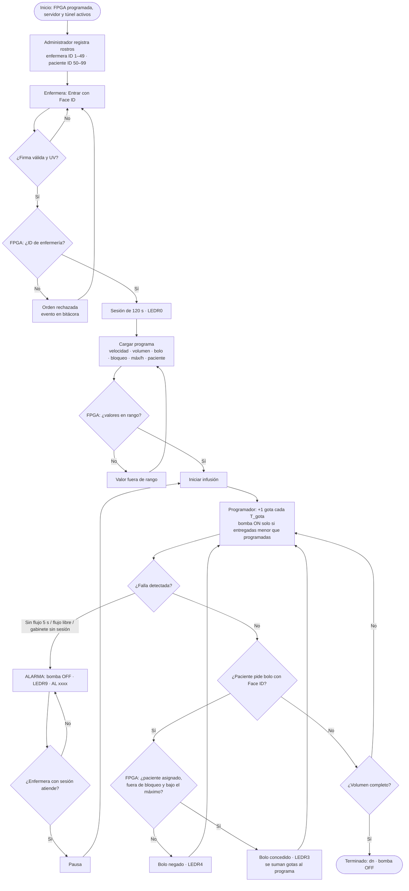

### 4.3 Diagrama de estados (infusión)

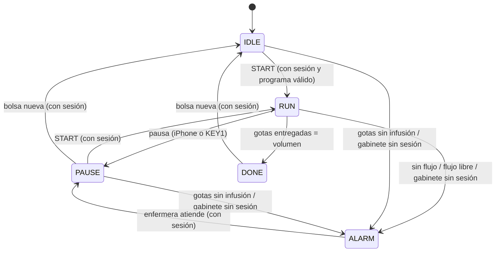

| Estado | Display | Bomba | Significado |
|---|---|---|---|
| IDLE | `id` | apagada | Sin infusión |
| RUN | `ru` | lazo cerrado | Infundiendo |
| PAUSE | `PA` | apagada | Pausa o alarma atendida |
| ALARM | `AL noFL` · `AL FrEE` · `AL tAPA` | apagada | Falla detectada |
| DONE | `dn` | apagada | Volumen completado |

Más diagramas (secuencia del inicio de sesión con Face ID y jerarquía de módulos): [docs/arquitectura.md](docs/arquitectura.md).

---

## 5. Metodología de implementación

### 5.1 Herramientas

| Herramienta | Uso |
|---|---|
| Verilog-2001 [6] | Descripción del hardware (12 módulos, 1,294 líneas) |
| Quartus Prime Lite 25.1 | Síntesis, ajuste, análisis de tiempos y programación del MAX 10 10M50DAF484C7G |
| Icarus Verilog 11 [13] | Simulación de los bancos de prueba |
| Python 3.11, Flask [10], py_webauthn [11] | Servidor web y verificación de las firmas de Face ID |
| `quartus_stp` (Tcl) [7] | Escritura y lectura de los registros JTAG desde Python |
| Cloudflare Quick Tunnel [12] | HTTPS con nombre de dominio para el iPhone |
| Tectonic (XeLaTeX) | Compilación del reporte |

### 5.2 Fundamentos del control

Con un equipo de macrogoteo de $F = 20$ gotas/mL, el intervalo entre gotas para una velocidad $Q$ en mL/h es

$$T_{\text{gota}} = \frac{3\,600\,000}{Q \cdot F}\ \text{ms}$$

360 mL/h corresponden a una gota cada 500 ms y 999 mL/h a una cada 180 ms. Un programador interno suma una gota a $n_s$ cada $T_{\text{gota}}$, y la bomba se enciende solo mientras las gotas entregadas $n_d$ son menores que las programadas:

$$\text{bomba} = (\text{estado} = \text{RUN}) \land (n_d < n_s)$$

Así la bomba entrega exactamente lo programado aunque su caudal real varíe. Las mismas cuentas supervisan el equipo: **bomba encendida sin gotas → sin flujo**; **más gotas de las programadas → flujo libre**.

### 5.3 Procedimiento

1. **Arquitectura y protocolo.** Se definió qué decide la FPGA (todo) y qué hace la laptop (verificar firmas y transportar). También se definió un protocolo de órdenes de 32 bits con número de secuencia y un estado de 224 bits ([docs/protocolo-jtag.md](docs/protocolo-jtag.md)).
2. **Diseño en Verilog por módulos:**

   | Módulo | Función |
   |---|---|
   | [`cmd_ctrl`](rtl/cmd_ctrl.v) | Roles, sesión de 120 s, rangos e identidad del paciente |
   | [`infusion_ctrl`](rtl/infusion_ctrl.v) | Máquina de estados, programador de gotas, lazo cerrado y alarmas |
   | [`bolus_limiter`](rtl/bolus_limiter.v) | Bloqueo entre bolos y ventana deslizante de 60 min con 8 marcas de tiempo |
   | [`divu`](rtl/divu.v) | Divisor secuencial de 32 bits para $T_{\text{gota}}$, sin multiplicadores ni divisores combinacionales |
   | [`drip_sim`](rtl/drip_sim.v) | Modelo de bomba y goteo: 150 ms con bomba, 120 ms con llave abierta, ninguna gota con tubo tapado |
   | [`jtag_link`](rtl/jtag_link.v) | `altsource_probe` con source de 32 b y probe de 224 b |
   | [`dispenser_top`](rtl/dispenser_top.v) | Integración, bitácora con cola de eventos, displays y LEDs |
   | Soporte | [`sync_debounce`](rtl/sync_debounce.v), [`tick_gen`](rtl/tick_gen.v), [`pwm`](rtl/pwm.v), [`buzzer_ctrl`](rtl/buzzer_ctrl.v), [`display_utils`](rtl/display_utils.v) |

3. **Verificación por simulación.** Hay un banco por módulo crítico y uno de sistema que actúa como la laptop: escribe el registro *source* y lee el *probe* con el mismo mapa de bits que el servidor.
4. **Servidor y Face ID.** El registro está protegido con PIN de administrador. Exige autenticador de plataforma, credencial residente y verificación de usuario (UV). Cada autenticación usa un reto aleatorio y se verifican origen, dominio, firma y contador.
5. **Síntesis, programación y pruebas en la tarjeta.** Cada caso se ejecutó en la DE10-Lite y se documentó con fotografía de la tarjeta y captura de la página. Los errores encontrados se corrigieron y se agregaron a las pruebas automáticas.

### 5.4 Estrategia de evaluación

| Nivel | Qué se mide | Criterio de éxito |
|---|---|---|
| Unidad | Divisor, limitador de bolos, controlador de infusión | 0 fallas contra los valores esperados |
| Sistema (simulación) | Secuencia completa de uso con órdenes por JTAG | Todas las reglas aplicadas y alarmas detectadas |
| Servidor | WebAuthn real con autenticador P-256 de software | Firmas alteradas y sin UV rechazadas |
| Tarjeta | Nueve casos de uso y tiempos de detección | Comportamiento igual al de simulación |

---

## 6. Protagonismo de la FPGA

La rúbrica pide que la FPGA realice al menos el 80 % de la función principal. La tabla reparte cada función del dispensador entre la FPGA y los equipos de apoyo:

| Función del dispensador | FPGA | Laptop / iPhone |
|---|:---:|:---:|
| Sesión de enfermería y tiempo límite | ✅ | |
| Roles (enfermería 1–49, pacientes 50–99) | ✅ | |
| Validación de rangos de los parámetros | ✅ | |
| Identidad del paciente para el bolo | ✅ | |
| Cálculo del intervalo entre gotas | ✅ | |
| Dosificación en lazo cerrado y control de la bomba | ✅ | |
| Limitador de bolos PCA (bloqueo y ventana de 60 min) | ✅ | |
| Detección de alarmas (sin flujo, flujo libre, manipulación) | ✅ | |
| Bitácora de eventos | ✅ | |
| Interfaz local (displays, LEDs, KEY1, switches) | ✅ | |
| Verificación criptográfica de Face ID | | ✅ |
| Interfaz web y transporte de órdenes | | ✅ |

**10 de 12 funciones (83 %) y todas las decisiones clínicas** se ejecutan en la FPGA. La laptop y el iPhone funcionan como interfaz: si la laptop enviara una orden indebida, la FPGA la rechazaría y la registraría en la bitácora. Una vez iniciada, el programador de gotas, el lazo de control y la supervisión de alarmas corren en la FPGA sin intervención de la laptop; esta solo lee el estado para mostrarlo.

---

## 7. Casos de estudio

Cada caso se probó en la tarjeta real ([guion completo](docs/guion-demo.md)):

| # | Caso | Entrada | Respuesta esperada de la FPGA |
|---|---|---|---|
| 1 | Infusión correcta | Enfermera autenticada programa e inicia | `ru`, lazo cerrado, mL aumentan |
| 2 | Orden sin sesión | *Iniciar* o *Cargar programa* sin Face ID | Rechazo |
| 3 | Valor fuera de rango | Velocidad 0 o 2000 mL/h | Rechazo "fuera de rango" |
| 4 | Bolo del paciente | Face ID del paciente 55, dos veces | 1.º concedido, 2.º negado por bloqueo |
| 5 | Bolo de otra persona | Face ID de otro paciente o de la enfermera | Rechazo |
| 6 | Flujo libre | Abrir la llave a mano (SW7 o panel) | `AL FrEE`, bomba apagada |
| 7 | Bolsa vacía / tubo tapado | SW6 o panel | `AL noFL` a los 5 s |
| 8 | Gabinete abierto | SW5 o panel, sin y con sesión | `AL tAPA` sin sesión; sin alarma con sesión |
| 9 | Atención y fin | Enfermera atiende; volumen completo | `PA`; `dn` |

---

## 8. Resultados

### 8.1 Síntesis en Quartus

| Recurso | Usado | Disponible |
|---|---:|---:|
| Elementos lógicos | 2,595 (5 %) | 49,760 |
| Funciones combinacionales | 2,269 (5 %) | 49,760 |
| Registros | 1,402 (3 %) | 49,760 |
| Pines | 107 (30 %) | 360 |
| Memoria, multiplicadores, PLL | 0 | — |
| **Fmax** (reloj de 50 MHz, modelo lento 85 °C) | **72.81 MHz** | holgura +5.56 ns |
| Fmax reloj JTAG | 98.48 MHz | — |

### 8.2 Pruebas automáticas

| Prueba | Qué verifica | Resultado |
|---|---|---:|
| [tb_divu](sim/tb_divu.v) | Divisor secuencial contra el cociente exacto | 205/205 |
| [tb_bolus_limiter](sim/tb_bolus_limiter.v) | Bloqueo, máximo por hora y ventana de 60 min | 10/10 |
| [tb_infusion_ctrl](sim/tb_infusion_ctrl.v) | Lazo cerrado, alarmas, pausa y fin | 20/20 |
| [tb_system](sim/tb_system.v) | Sistema completo con órdenes por JTAG | 33/33 |
| [test_server.py](server/test_server.py) | WebAuthn, roles, firma alterada, UV = 0, bolos, simulación | 29/29 |
| **Total** | | **297/297** |

### 8.3 Tiempos de detección en la tarjeta (999 mL/h)

| Falla simulada | Alarma | Tiempo medido |
|---|---|---:|
| Llave abierta a mano | Flujo libre | 0.7 s |
| Tubo tapado / bolsa vacía | Sin flujo | 5.6 s |
| Gabinete abierto sin sesión | Manipulación | 0.1 s |
| Gabinete abierto con sesión | Ninguna (permitido) | — |

Además, una lectura completa del estado por JTAG tarda unos **7 ms**.

### 8.4 Evidencia en la tarjeta

| Reposo | Infusión | Bloqueo de bolo | Alarma atendida | Fin |
|:---:|:---:|:---:|:---:|:---:|
| 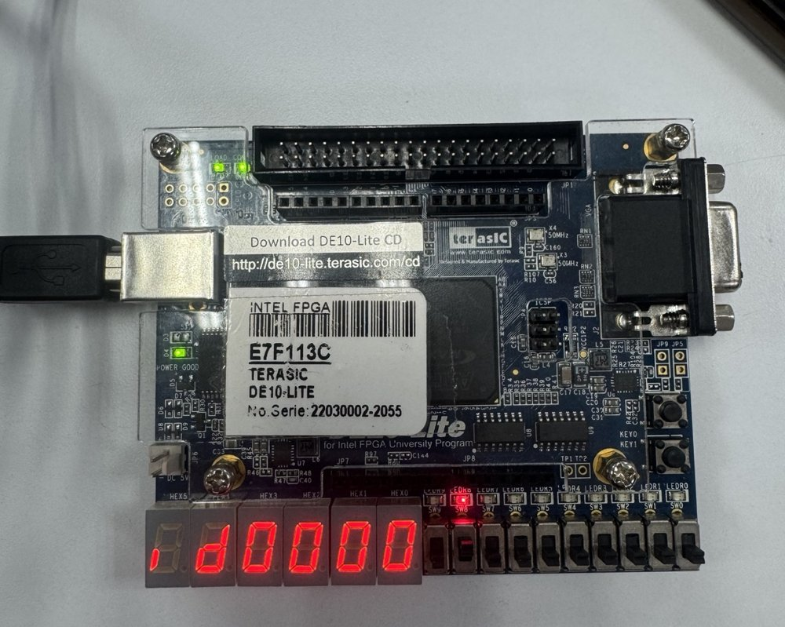 | 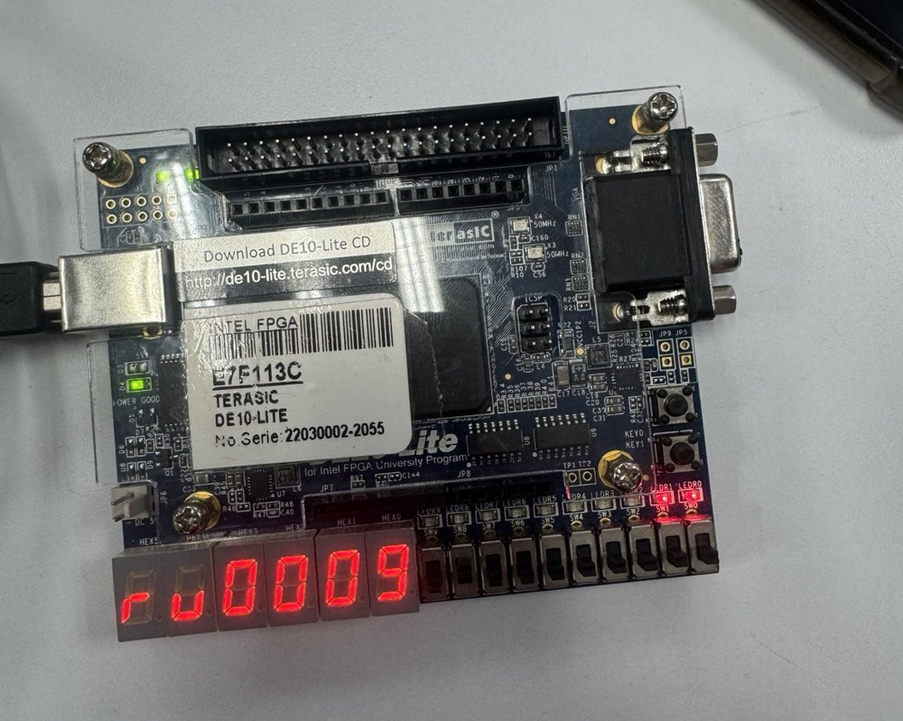 | 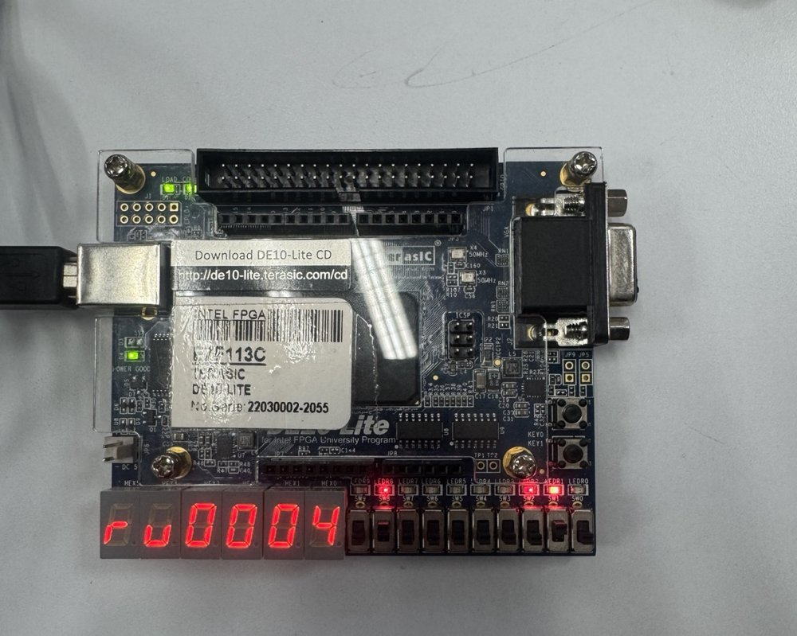 | 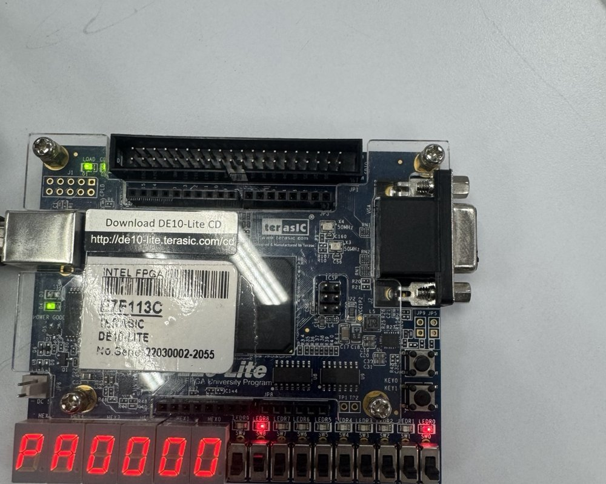 | 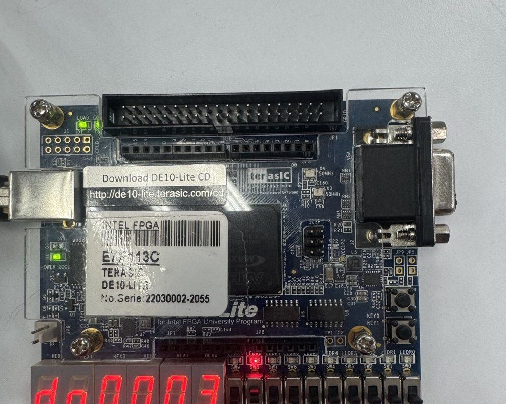 |
| `id 0000` | `ru 0009` | `ru 0004` (min) | `PA 0000` | `dn 0003` |

| Flujo libre | Sin flujo | Manipulación | Registro de passkey | Inicio con Face ID |
|:---:|:---:|:---:|:---:|:---:|
|  | 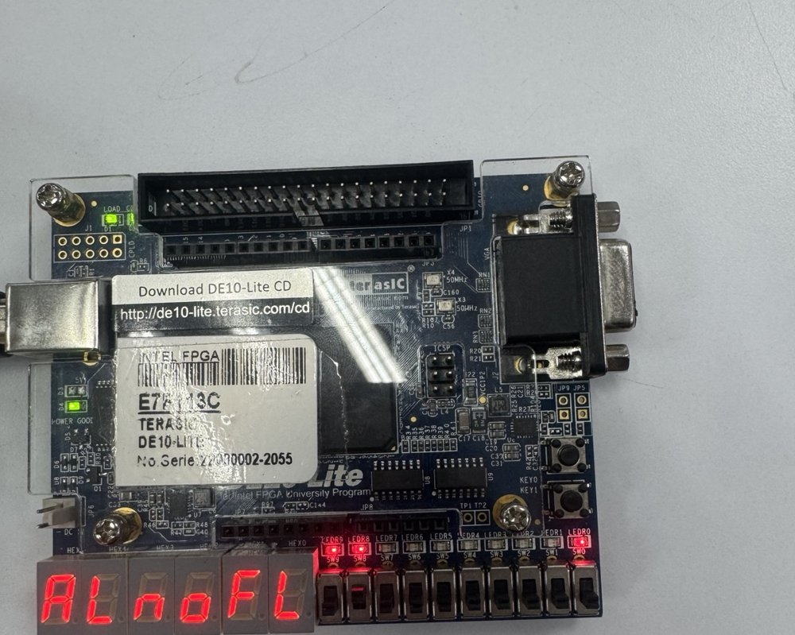 |  | 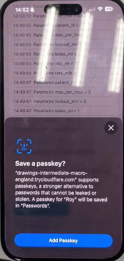 |  |
| `AL FrEE` | `AL noFL` | `AL tAPA` | Safari | Safari |

Las capturas de la página para cada caso están en [capturas/](capturas) y el detalle en [docs/pruebas-y-resultados.md](docs/pruebas-y-resultados.md).

### 8.5 Errores encontrados al probar en la tarjeta

| Síntoma | Causa | Corrección |
|---|---|---|
| 2000 mL/h quedaba en 976 mL/h | El campo de valor tiene 10 bits y se truncaba | El servidor valida el rango antes de enviar |
| Un bolo negado aparecía como aceptado en el iPhone | La orden se acusaba antes de que el limitador decidiera | El servidor espera el evento de concesión o rechazo |
| Alarma de sin flujo con 0 mL sin falla aparente | Un switch seleccionaba un sensor externo no conectado | Se eliminó esa opción; el goteo siempre se simula |
| El flujo libre tardaba 6.5 s | La fuga simulada era más lenta que la bomba | Fuga de una gota cada 120 ms → 0.7 s |

---

## 9. Análisis comparativo

### Cuantitativo: diseño contra medición

| Magnitud | Valor de diseño | Medido | Comentario |
|---|---:|---:|---|
| Gotas en 3 s a 360 mL/h | 6 | 5–7 | Coincide con $T_{\text{gota}}$ = 500 ms (simulación) |
| Detección de sin flujo | umbral de 5 s | 5.6 s | Umbral + tiempo hasta el primer encendido de la bomba |
| Detección de flujo libre | > 3 gotas extra | 0.7 s | Fuga de 120 ms/gota contra 180 ms/gota programada |
| Manipulación del gabinete | 20 ms de antirrebote | 0.1 s | Incluye la latencia de lectura por JTAG |
| Reloj del sistema | 50 MHz | Fmax 72.81 MHz | 45 % de margen de frecuencia |
| Uso del dispositivo | — | 5 % LE | Espacio para sensores y actuadores reales |

### Cualitativo: autenticación en el equipo

| Criterio | Llave física / código | Huella o RFID en el equipo | Face ID con passkey (este proyecto) |
|---|---|---|---|
| Identifica a la persona | No | Sí (RFID: no, se presta) | Sí |
| Hardware adicional | Cerradura o teclado | Sensor y módulo de comunicación | Ninguno |
| Riesgo si se copia o filtra | Alto | Medio | El servidor no guarda secretos; solo la llave pública [3] |
| Trazabilidad de cada orden | No | Parcial | Sí, con ID en la bitácora de la FPGA |
| Dónde se aplican las reglas | En el equipo | En el equipo | En hardware (FPGA), independiente de la laptop |

---

## 10. Conclusiones y trabajo futuro

### Conclusiones

- Se implementó un dispensador de medicamento líquido en la DE10-Lite que **solo acepta órdenes de personas autenticadas con Face ID**. La FPGA controla la infusión gota a gota en lazo cerrado, limita los bolos del paciente y detecta flujo libre, ausencia de flujo y apertura no autorizada del gabinete, en 0.7, 5.6 y 0.1 s.
- Las passkeys de WebAuthn permitieron usar el Face ID del iPhone **sin desarrollar una aplicación ni comprar un sensor biométrico**. El bloque In-System Sources and Probes comunicó la laptop con la FPGA por el mismo cable de programación.
- El diseño ocupa el 5 % del dispositivo y cumple tiempos con 45 % de margen.
- Las pruebas en la tarjeta encontraron errores que la simulación no había revelado, lo que muestra el valor de validar en hardware real.

### Limitaciones

- La bomba, la cámara de goteo y las fallas se simulan dentro de la FPGA. Los resultados demuestran la lógica de control, no el comportamiento hidráulico.
- La orden `SIM` existe solo para la demostración y no requiere autenticación.
- La laptop verifica las firmas: un atacante con control de la laptop podría abrir una sesión sin rostro, aunque seguiría limitado por los rangos y bolos de la FPGA.
- El túnel rápido cambia de dirección en cada inicio y obliga a registrar de nuevo los rostros.

### Trabajo futuro

- Conectar una bomba peristáltica y un sensor óptico de gotas reales. Las salidas PWM y de puente H ya están en GPIO.
- Eliminar la orden `SIM` y leer interruptores físicos del gabinete.
- Llevar el protocolo de órdenes a UART o Ethernet y la verificación de identidad a un servidor dedicado con dominio fijo.
- Firmar las órdenes de extremo a extremo para que la FPGA verifique la autenticidad sin confiar en la laptop.
- Generar el layout del limitador de bolos (`bolus_limiter`, bloque autocontenido) con OpenLane y SKY130.

---

## 11. Instrucciones de ejecución

Guía completa con requisitos y solución de problemas: **[docs/como-correr.md](docs/como-correr.md)**.

### Requisitos

- Windows con Quartus Prime **Lite 25.1** + soporte **MAX 10** (incluye el driver del USB-Blaster)
- Python 3.11 → `python -m pip install -r server/requirements.txt`
- Icarus Verilog y Git Bash (solo para la simulación)
- `winget install --id Cloudflare.cloudflared` (solo para el iPhone)

### Paso a paso

```bash
# 1. Simulación de la lógica de la FPGA (sin tarjeta)
bash sim/run_all.sh
```

```powershell
# 2. Página con la FPGA simulada en software (sin tarjeta)
.\scripts\servidor.ps1 -Mock -Pin 123456        # abre http://localhost:5000

# 3. Compilar (opcional: el .sof ya está en quartus/output_files)
.\scripts\compilar.ps1

# 4. Programar la DE10-Lite conectada por USB  -> displays "id 0000"
.\scripts\programar.ps1

# 5. Servidor conectado a la tarjeta
.\scripts\servidor.ps1 -Pin 123456

# 6. En otra terminal: HTTPS para el iPhone
.\scripts\tunel.ps1                              # abre la URL https://...trycloudflare.com en Safari
```

En el iPhone:

1. Registra los rostros en *Registrar una cara (administrador)* con el PIN: enfermera con ID 1–49 y paciente con ID 50–99.
2. Entra con Face ID, carga el programa e inicia.
3. Sigue el [guion de la demostración](docs/guion-demo.md).

### Controles de la tarjeta

| Control | Función |
|---|---|
| KEY0 / KEY1 | Reinicio / pausa local |
| SW9 | Modo demostración (1 min clínico = 1 s) |
| SW7 · SW6 · SW5 | Simulan llave abierta · tubo tapado · gabinete abierto |
| SW1–SW0 | Display: mL · velocidad · min de bloqueo · ID de enfermera |
| LEDR0 · 1 · 2 · 3 · 4 · 5 · 8 · 9 | Sesión · bomba · gota · bolo concedido · rechazo · gabinete · latido · alarma |

Detalle en [docs/tarjeta-de10lite.md](docs/tarjeta-de10lite.md).

---

## 12. Estructura del repositorio

```
├── rtl/          Verilog de la FPGA (12 módulos)
├── sim/          Bancos de prueba (Icarus Verilog) y run_all.sh
├── quartus/      Proyecto Quartus (.qpf/.qsf/.sdc) y .sof/.pof compilados
├── server/       Servidor Flask: Face ID (WebAuthn) y puente JTAG (quartus_stp)
├── scripts/      Compilar, programar, servidor, túnel y demo guiada
├── docs/         Arquitectura, protocolo JTAG, tarjeta, pruebas y guion de demo
├── capturas/     Capturas de la página en cada caso de prueba
└── reporte/      Reporte en LaTeX y PDF, fotos de la tarjeta y del iPhone
```

| Documento | Contenido |
|---|---|
| [docs/arquitectura.md](docs/arquitectura.md) | Diagramas, secuencia de Face ID, módulos, FSM y alarmas |
| [docs/protocolo-jtag.md](docs/protocolo-jtag.md) | Formato de órdenes, códigos, mapa de 224 bits y bitácora |
| [docs/tarjeta-de10lite.md](docs/tarjeta-de10lite.md) | Switches, botones, displays, LEDs y GPIO |
| [docs/pruebas-y-resultados.md](docs/pruebas-y-resultados.md) | Recursos, pruebas, fotos y tiempos |
| [docs/como-correr.md](docs/como-correr.md) | Instalación y ejecución paso a paso |
| [docs/guion-demo.md](docs/guion-demo.md) | Casos para la presentación |

---

## 13. Referencias

[1] U.S. Food and Drug Administration, "Infusion pump improvement initiative," 2010. [Online]. Available: https://www.fda.gov/medical-devices/infusion-pumps/infusion-pump-improvement-initiative

[2] World Wide Web Consortium, *Web Authentication: An API for Accessing Public Key Credentials, Level 2*, W3C Recommendation, Apr. 2021. [Online]. Available: https://www.w3.org/TR/webauthn-2/

[3] Apple Inc., "About the security of passkeys," Apple Support. [Online]. Available: https://support.apple.com/en-us/102195

[4] Apple Inc., "Biometric security," in *Apple Platform Security*. [Online]. Available: https://support.apple.com/guide/security/biometric-security-sec067eb0c9e/web

[5] Terasic Inc., "DE10-Lite Development and Education Board." [Online]. Available: https://www.terasic.com.tw/cgi-bin/page/archive.pl?Language=English&No=1021

[6] *IEEE Standard Verilog Hardware Description Language*, IEEE Std 1364-2001, IEEE Standards Association. [Online]. Available: https://standards.ieee.org/ieee/1364/2052/

[7] Altera Corporation, "Design debugging using In-System Sources and Probes," in *Quartus Prime Standard Edition User Guide: Debug Tools*, ver. 18.1, cap. 8. [Online]. Available: https://docs.altera.com/r/docs/683552/current

[8] *IEEE Standard for Test Access Port and Boundary-Scan Architecture*, IEEE Std 1149.1-2013, IEEE Standards Association. [Online]. Available: https://standards.ieee.org/ieee/1149.1/4484/

[9] P. P. Chu, *FPGA Prototyping by Verilog Examples*. Hoboken, NJ, USA: Wiley, 2008. [Online]. Available: https://doi.org/10.1002/9780470374283

[10] Pallets Projects, "Flask documentation." [Online]. Available: https://flask.palletsprojects.com/en/stable/

[11] Duo Labs, "py_webauthn: Pythonic WebAuthn," GitHub repository. [Online]. Available: https://github.com/duo-labs/py_webauthn

[12] Cloudflare Inc., "Quick Tunnels," Cloudflare Tunnel documentation. [Online]. Available: https://developers.cloudflare.com/tunnel/get-started/quick-tunnels/

[13] S. Williams, "Icarus Verilog." [Online]. Available: https://steveicarus.github.io/iverilog/
