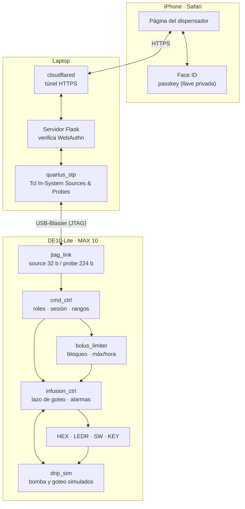
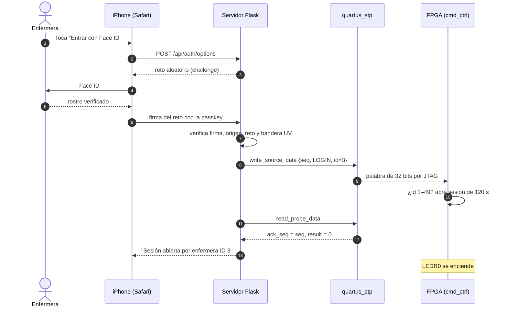
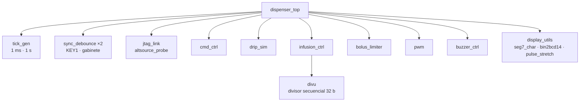
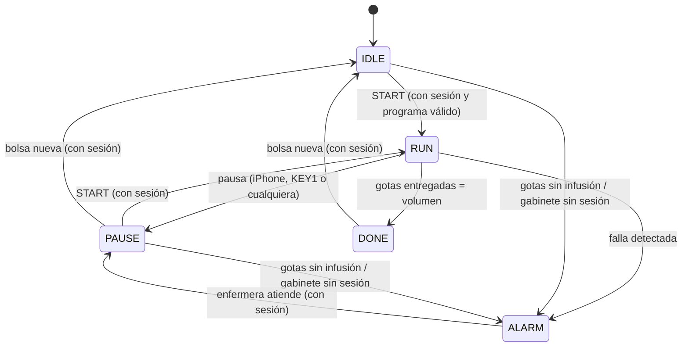

# Arquitectura del sistema

El dispensador tiene tres partes. El **iPhone** es la interfaz y aporta la identidad con Face ID. La **laptop** verifica la firma y transporta órdenes. La **DE10-Lite** toma todas las decisiones.



Solo hay **un cable**: el USB de la tarjeta. Ese mismo cable programa la FPGA y lleva las órdenes y el estado, a través del bloque *In-System Sources and Probes* de Quartus. No se usa ESP32, UART, Wi-Fi ni ningún sensor externo.

## Qué hace cada parte

| Parte | Responsabilidad | No hace |
|---|---|---|
| iPhone | Pide Face ID y firma el reto con la passkey | No decide nada |
| Laptop ([server/](../server)) | Verifica la firma WebAuthn (origen, reto, UV) y traduce la orden a 32 bits | No aplica reglas de dosis: si manda algo indebido, la FPGA lo rechaza |
| FPGA ([rtl/](../rtl)) | Sesión, roles, rangos, paciente asignado, dosificación, bolos, alarmas, bitácora | — |

## Flujo de un inicio de sesión con Face ID



Un **bolo** sigue el mismo camino con la passkey del paciente. La FPGA comprueba primero que el ID sea el del paciente asignado y después el limitador decide si lo concede (tiempo de bloqueo y máximo por hora). El servidor espera el evento de concesión o rechazo antes de responder al iPhone.

## Módulos de la FPGA



| Módulo | Archivo | Función |
|---|---|---|
| `dispenser_top` | [rtl/dispenser_top.v](../rtl/dispenser_top.v) | Integra todo, bitácora de eventos, mapa de la sonda, displays y LEDs |
| `cmd_ctrl` | [rtl/cmd_ctrl.v](../rtl/cmd_ctrl.v) | Decodifica órdenes, sesión de 120 s, rangos, identidad del paciente |
| `infusion_ctrl` | [rtl/infusion_ctrl.v](../rtl/infusion_ctrl.v) | Máquina de estados, programador de gotas, lazo cerrado, alarmas |
| `bolus_limiter` | [rtl/bolus_limiter.v](../rtl/bolus_limiter.v) | Bloqueo entre bolos y ventana deslizante de 60 min (8 marcas de tiempo) |
| `divu` | [rtl/divu.v](../rtl/divu.v) | Calcula el intervalo entre gotas sin multiplicadores ni divisores combinacionales |
| `drip_sim` | [rtl/drip_sim.v](../rtl/drip_sim.v) | Gota cada 150 ms con bomba, cada 120 ms con llave abierta, ninguna con tubo tapado |
| `jtag_link` | [rtl/jtag_link.v](../rtl/jtag_link.v) | Instancia `altsource_probe` (source 32 b, probe 224 b) |
| `sync_debounce` | [rtl/sync_debounce.v](../rtl/sync_debounce.v) | Sincronizador + antirrebote de 20 ms |
| `tick_gen` | [rtl/tick_gen.v](../rtl/tick_gen.v) | Pulsos de 1 ms y 1 s, tiempo encendido |
| `pwm`, `buzzer_ctrl` | [rtl/pwm.v](../rtl/pwm.v), [rtl/buzzer_ctrl.v](../rtl/buzzer_ctrl.v) | Salidas opcionales en GPIO para bomba y zumbador reales |
| `display_utils` | [rtl/display_utils.v](../rtl/display_utils.v) | Caracteres de 7 segmentos, binario a BCD, alargador de pulsos para LEDs |

## Dosificación gota a gota en lazo cerrado

Con un equipo de macrogoteo de **20 gotas/mL**, el intervalo entre gotas para una velocidad *Q* (mL/h) es:

```
T_gota [ms] = 3 600 000 / (Q · 20)
```

360 mL/h → una gota cada 500 ms · 999 mL/h → una gota cada 180 ms.

Un programador suma una gota a `sched_drops` cada `T_gota`. La bomba se enciende **solo** mientras `delivered_drops < sched_drops`. Así entrega exactamente lo programado aunque su caudal real varíe. Las mismas cuentas sirven para supervisar:

- bomba encendida sin gotas → **sin flujo**;
- más gotas de las programadas → **flujo libre**.

## Máquina de estados de la infusión



| Estado | Display HEX5–4 | Bomba |
|---|---|---|
| IDLE | `id` | apagada |
| RUN | `ru` | lazo cerrado |
| PAUSE | `PA` | apagada |
| ALARM | `AL` | apagada |
| DONE | `dn` | apagada |

## Alarmas

| Alarma | Condición en la FPGA | Display |
|---|---|---|
| Sin flujo | Bomba encendida 5 s sin detectar gotas (bolsa vacía o tubo tapado) | `AL noFL` |
| Flujo libre | Entregadas > programadas + 3 durante la infusión, o 3 gotas con la infusión detenida | `AL FrEE` |
| Manipulación | Gabinete abierto sin sesión de enfermería | `AL tAPA` |

Solo una enfermera con sesión puede atender una alarma; la infusión queda en pausa y hay que reiniciarla explícitamente. Si la falla sigue presente, la alarma vuelve a dispararse.

## Por qué Face ID con passkeys

- **Sin app ni Mac:** WebAuthn funciona desde Safari; no hace falta desarrollar en Swift.
- **Sin hardware extra:** no se compró sensor de huella ni módulo biométrico.
- **El servidor nunca conoce la llave privada:** solo guarda la llave pública y verifica firmas.
- **Verificación de usuario obligatoria (UV):** una firma sin Face ID se rechaza.
- **Cada passkey está ligada al dominio:** por eso se necesita HTTPS con nombre de dominio (el túnel), no una IP.
