# Pruebas y resultados

## Síntesis en Quartus Prime Lite 25.1

Dispositivo **10M50DAF484C7G** (MAX 10). Resumen completo en [quartus/output_files/](../quartus/output_files).

| Recurso | Usado | Disponible |
|---|---:|---:|
| Elementos lógicos | 2,595 (5 %) | 49,760 |
| Funciones combinacionales | 2,269 (5 %) | 49,760 |
| Registros | 1,402 (3 %) | 49,760 |
| Pines | 107 (30 %) | 360 |
| Memoria, multiplicadores, PLL | 0 | — |
| **Fmax** (reloj de 50 MHz, modelo lento 85 °C) | **72.81 MHz** | holgura +5.56 ns |
| Fmax reloj JTAG | 98.48 MHz | — |

El intervalo entre gotas se calcula con un divisor secuencial (`divu`), por eso el diseño no usa ningún multiplicador ni divisor combinacional.

## Pruebas automáticas

| Prueba | Qué verifica | Resultado |
|---|---|---:|
| [tb_divu](../sim/tb_divu.v) | Divisor secuencial contra el cociente exacto | 205/205 |
| [tb_bolus_limiter](../sim/tb_bolus_limiter.v) | Bloqueo, máximo por hora y ventana deslizante de 60 min | 10/10 |
| [tb_infusion_ctrl](../sim/tb_infusion_ctrl.v) | Lazo cerrado, alarmas, pausa y fin | 20/20 |
| [tb_system](../sim/tb_system.v) | Sistema completo con órdenes por JTAG, como lo haría la laptop | 33/33 |
| [test_server.py](../server/test_server.py) | WebAuthn, roles, firma alterada, UV = 0, bolos, panel de simulación | 29/29 |

La prueba de sistema recorre:

- órdenes sin sesión;
- intento de abrir sesión con un ID de paciente;
- valores fuera de rango;
- infusión (5–7 gotas en 3 s a 360 mL/h);
- bolo concedido, bolo negado por bloqueo y bolo con el rostro de otra persona;
- las tres alarmas, por switch y por orden `SIM`;
- pausa con KEY1 y fin de la infusión.

## Pruebas en la tarjeta

| Caso | Tarjeta | Página |
|---|---|---|
| Reposo | 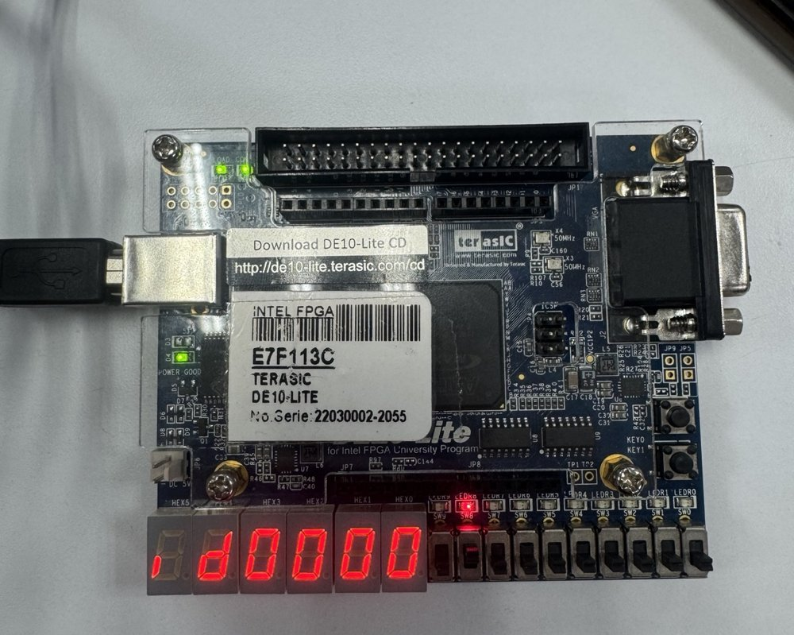 | 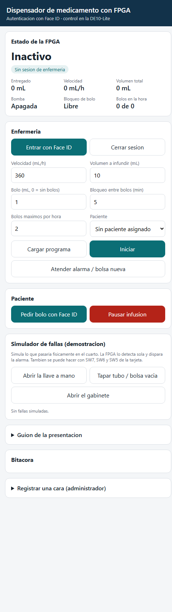 |
| Sesión y programa cargado | 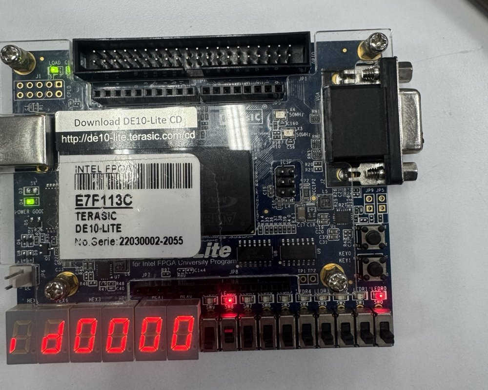 |  |
| Infusión a 999 mL/h | 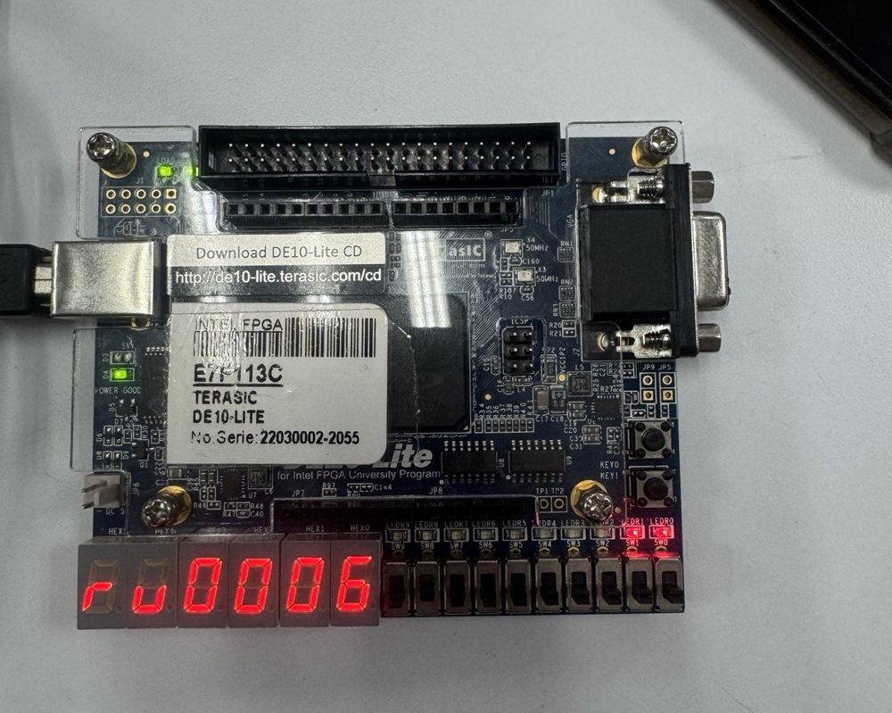 | 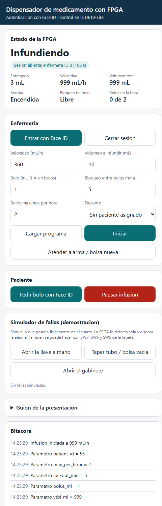 |
| Bloqueo de bolo (SW1) | 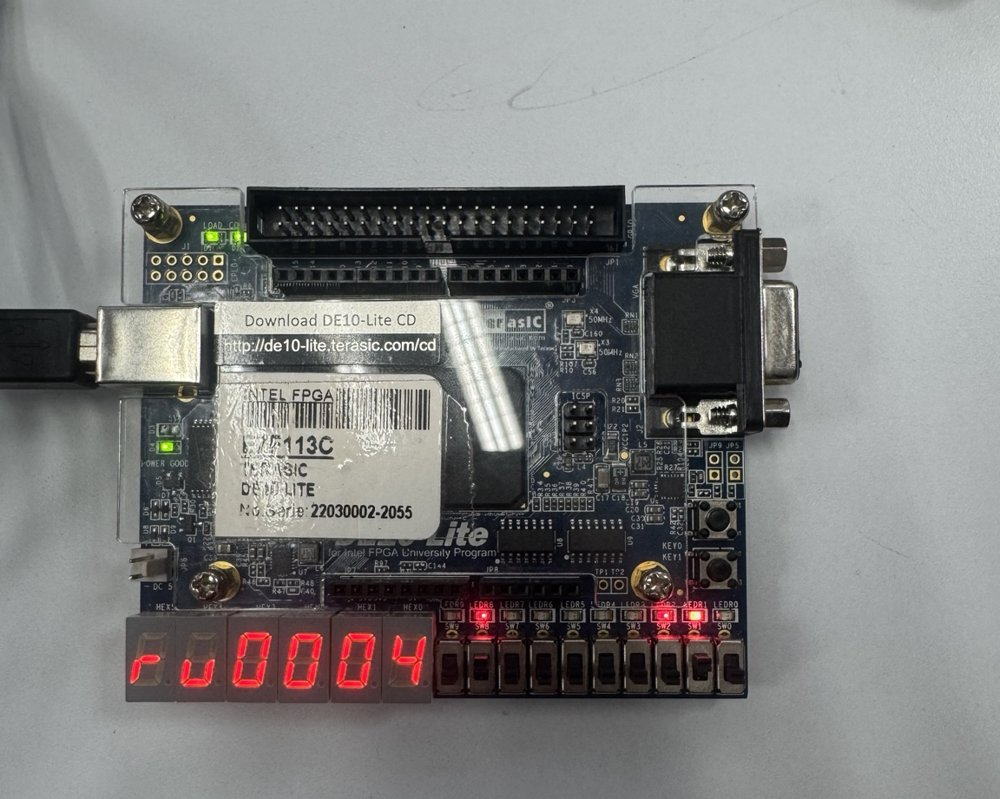 |  |
| Flujo libre | 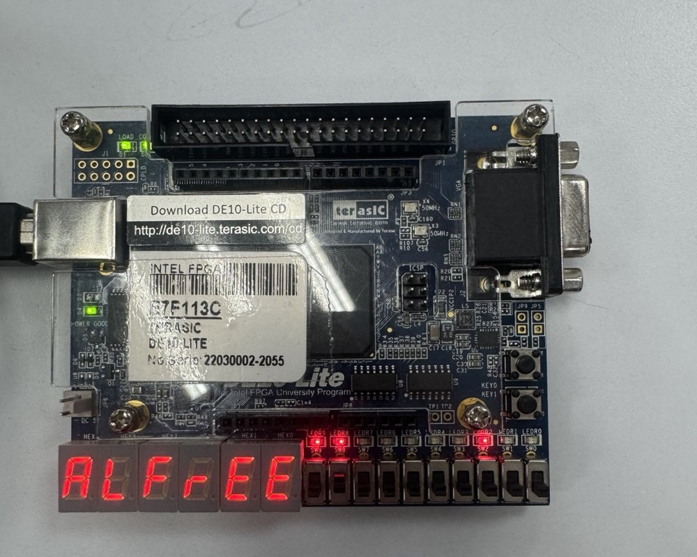 | 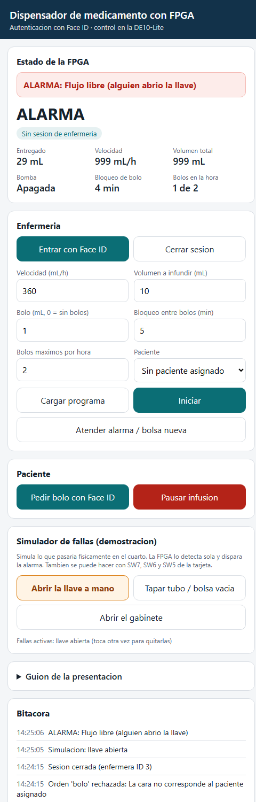 |
| Sin flujo | 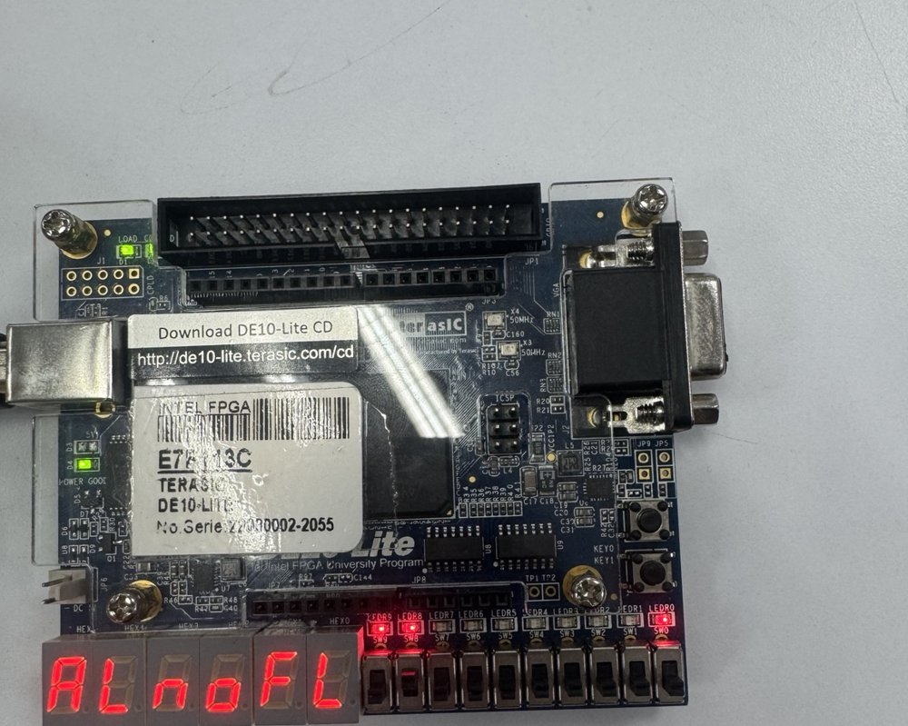 | 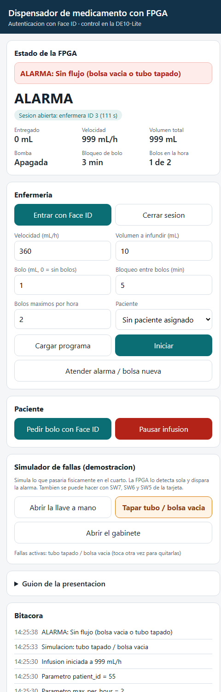 |
| Gabinete sin permiso | 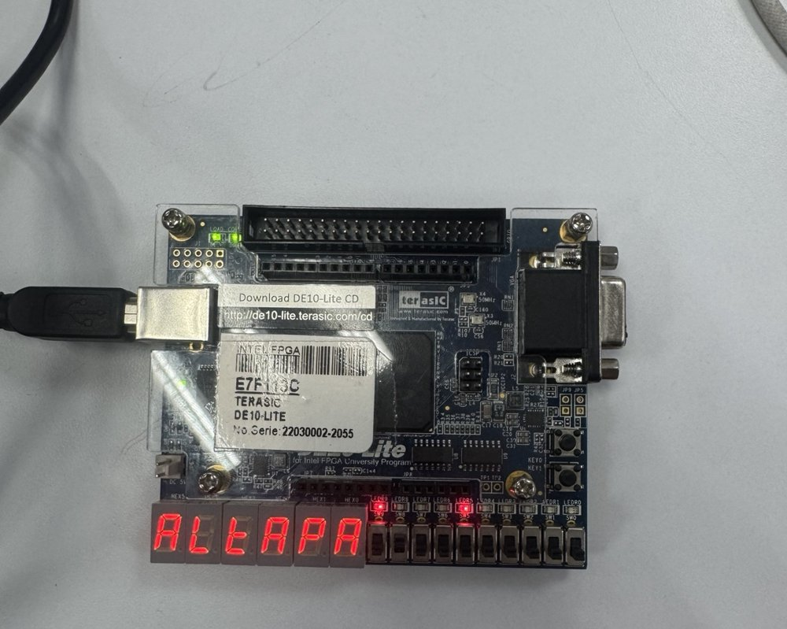 | 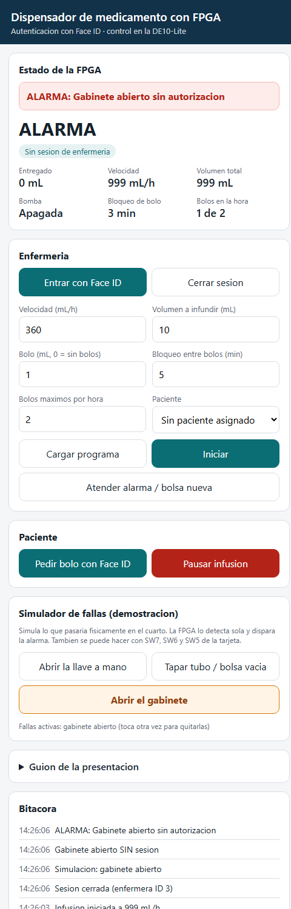 |
| Alarma atendida | 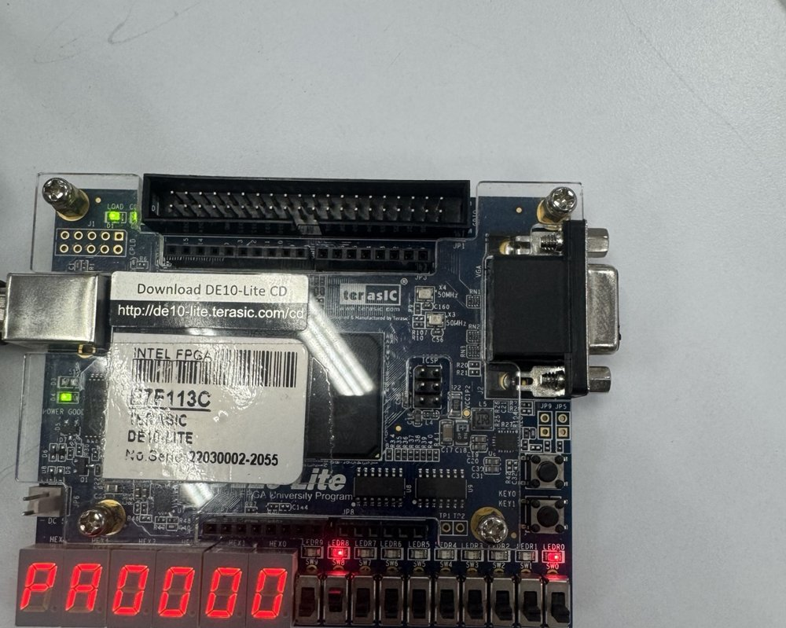 | 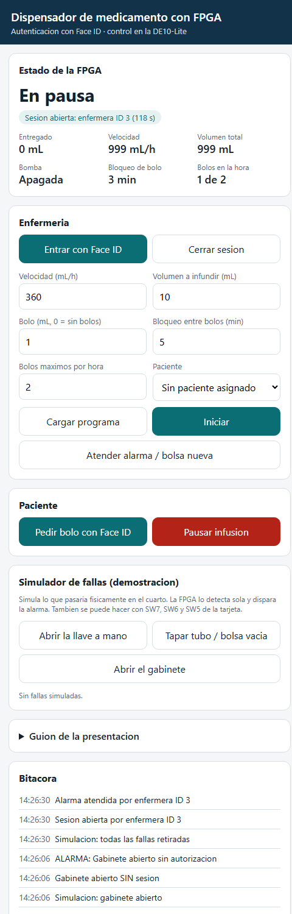 |
| Fin de la infusión | 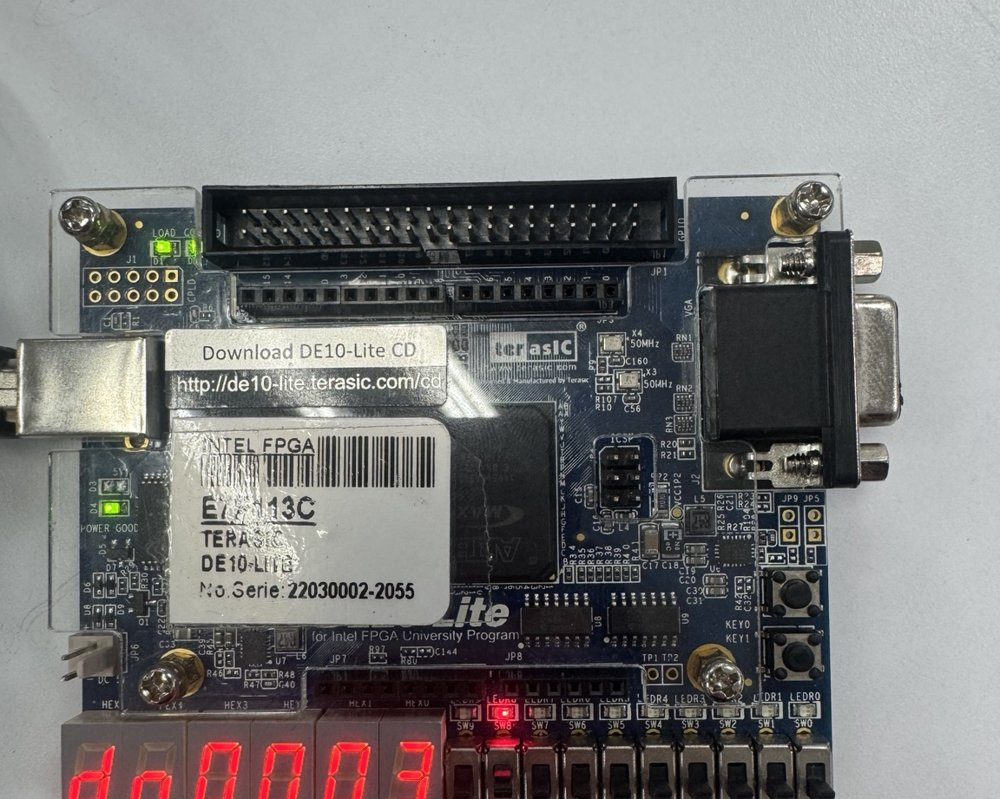 | 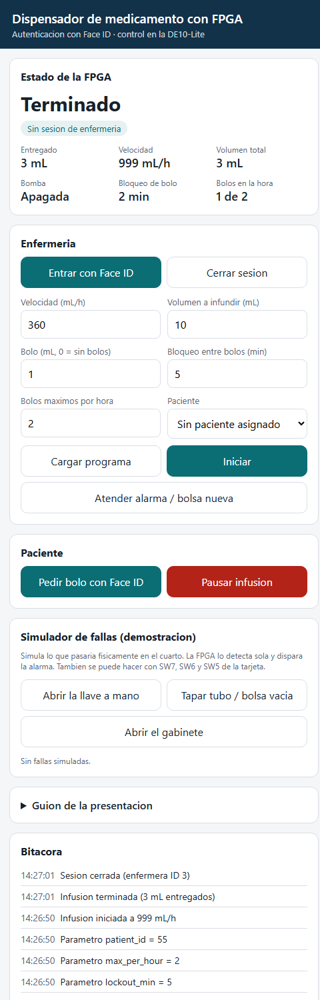 |

Órdenes rechazadas (velocidad 0 y bolo con el rostro de otra persona): [capturas/05_rechazos.png](../capturas/05_rechazos.png).

### Face ID en el iPhone

| Registro de la passkey | Inicio de sesión |
|---|---|
| 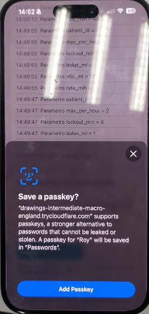 | 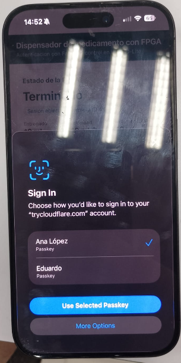 |

### Tiempos de detección medidos (999 mL/h)

| Falla simulada | Alarma | Tiempo |
|---|---|---:|
| Llave abierta a mano | Flujo libre | 0.7 s |
| Tubo tapado / bolsa vacía | Sin flujo | 5.6 s |
| Gabinete abierto sin sesión | Manipulación | 0.1 s |
| Gabinete abierto con sesión | Ninguna (permitido) | — |

Los 5.6 s de *sin flujo* son el umbral de 5 s más el tiempo hasta que la bomba se enciende por primera vez.

## Errores encontrados al probar en la tarjeta

Las pruebas con la tarjeta real encontraron fallas que la simulación no había mostrado. Todas quedaron corregidas y cubiertas por pruebas:

| Síntoma | Causa | Corrección |
|---|---|---|
| Una velocidad de 2000 mL/h quedaba en 976 | El campo de valor tiene 10 bits y se truncaba | El servidor valida el rango antes de enviar |
| Un bolo negado por bloqueo aparecía como "OK" en el iPhone | La orden se acusaba antes de que el limitador decidiera | El servidor espera el evento `0A`/`0B` de la FPGA |
| Alarma *sin flujo* con todo aparentemente bien (0 mL) | SW8 seleccionaba un sensor externo no conectado | Se quitó SW8; el goteo siempre se simula |
| El flujo libre tardaba 6.5 s en detectarse | La fuga simulada (400 ms) era más lenta que la bomba | Fuga de una gota cada 120 ms → 0.7 s |
| "223 eventos no leídos" después de KEY0 | El contador de eventos se reiniciaba | El servidor detecta el reinicio por el evento `01` |
| Safari ofrecía QR / llave de seguridad | Se intentó entrar sin ninguna cara registrada | La página avisa que primero hay que registrar |
